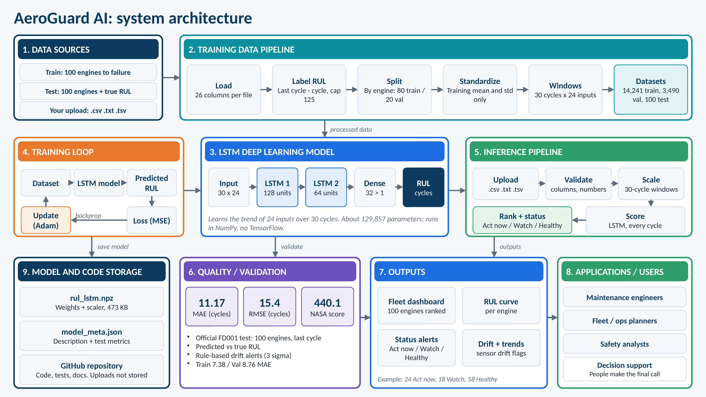

# AeroGuard AI

**Predictive maintenance for jet engines.** Upload engine sensor data and an LSTM neural network estimates each engine's **Remaining Useful Life (RUL)**, the number of operating cycles left before it needs service. The app ranks the fleet by urgency and raises *Act now / Watch / Healthy* alerts.

**Live demo: https://aero-guard-ai-x0r4.onrender.com/**
(Free hosting: if nobody has visited for a while, the first load can take about a minute.)



## Why this exists

Engines are traditionally serviced on fixed schedules or by fixed gauge limits. A schedule can be too early (wasted engine life) or too late (risk). AeroGuard reads all 24 inputs together as a 30-cycle trend, so maintenance can be planned per engine, with the most urgent engines first. It is decision support: engineers still make the final call.

## Features

- Upload `.csv`, `.txt` or `.tsv` sensor files (up to 20 MB), validated before anything is scored
- Fleet dashboard: ranked engine list, RUL curve per engine, status alerts, sensor drift flags
- Interactive 3D engine explorer with a scroll-driven exploded view
- Honest by design: no result is shown unless the model produced it, and a demo mode is clearly labelled as synthetic data

## Model and results

| Item | Value |
|---|---|
| Dataset | NASA C-MAPSS **FD001** (simulated turbofan engines) |
| Input | Last 30 cycles of 24 values (3 operating settings + 21 sensors) |
| Target | RUL in cycles, capped at 125 during training |
| Architecture | LSTM 128 → Dropout → LSTM 64 → Dropout → Dense 32 → Dense 1 (about 129,857 parameters) |
| Training | MSE loss, Adam (lr 0.001), batch 64, early stopping |
| Split | By engine: 80 train / 20 validation; official 100-engine test set held out |

| Data | MAE (cycles) | RMSE (cycles) |
|---|---|---|
| Training | 7.38 | 10.06 |
| Validation | 8.76 | 12.52 |
| **Official test (100 engines)** | **11.17** | **15.4** |

NASA scoring-function result on the test set: **440.1** (lower is better; late predictions are penalized more).

The trained weights are stored in `backend/models/rul_lstm.npz` and run in plain NumPy, so the server does not need TensorFlow.

## How it works

1. **Training (notebook):** load data → label RUL (last cycle − cycle, capped at 125) → split by engine → standardize with training statistics → build 30-cycle windows → train the LSTM.
2. **On upload (backend):** validate the file → scale → build a 30-cycle window for every row → score with the LSTM → take each engine's last cycle as its headline RUL → assign a status (RUL ≤ 30 *Act now*, ≤ 75 *Watch*, otherwise *Healthy*).

The alert limits of 30 and 75 cycles are product defaults, not model outputs. Drift alerts are a simple rule-based check (a sensor moving 3 or more standard deviations from the engine's early baseline).

## Tech stack

- **Frontend:** React, TypeScript, Vite, Tailwind, React Three Fiber, Recharts
- **Backend:** FastAPI, pandas, NumPy
- **Deployment:** Docker, Render

## Run locally

Backend (Python 3.11+):

```bash
cd backend
python -m venv .venv
.venv\Scripts\activate        # macOS/Linux: source .venv/bin/activate
pip install -r requirements.txt
uvicorn app.main:app --port 8000
```

Frontend (Node 20+), in a second terminal:

```bash
cd frontend
npm install
npm run dev
```

Open http://localhost:5173 and upload `test_FD001.txt` from the NASA dataset on the Analyze page. With that file you should see 24 *Act now*, 18 *Watch* and 58 *Healthy* engines.

Tests: `cd backend && pytest`

## Deploy

The included `Dockerfile` builds the frontend and serves it from the FastAPI backend as a single service. On Render: create a Web Service from this repository, choose Docker, and set the health check path to `/api/health`.

## Retrain or replace the model

1. Train in the notebook (keep the 24 inputs and the 30-cycle window).
2. Convert the saved model: `python tools/keras_to_npz.py model.keras scaler.joblib`
3. Update `backend/models/model_meta.json` with metrics you measured, and restart the backend.

## Limitations

- Trained and tested on **FD001 only**, which is simulated data. Accuracy on other engine types, operating conditions (FD002 to FD004) or real engines is unknown.
- RUL was capped at 125 in training, so predictions rarely exceed about 125 cycles.
- The model gives a single estimate with no confidence range.
- An engine's first 29 cycles are scored on a padded window and are less reliable.
- Scores come from one test set and one training run.

## Data and credits

Dataset: A. Saxena and K. Goebel (2008), *Turbofan Engine Degradation Simulation Data Set*, NASA Ames Prognostics Data Repository. The dataset is not included in this repository; download it from NASA.
